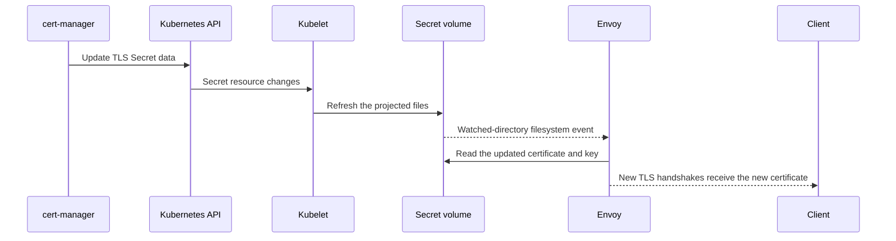

# TLS secrets and rotation

The gateway uses a Kubernetes TLS Secret for its downstream HTTPS certificate. Set `listener.https_hosts` and `server_tls.secret` in the gateway config:

```yaml
listener:
  https_hosts: [tls.example.com]
server_tls:
  secret: auth-gateway-tls
```

The Secret is type `kubernetes.io/tls` and contains `tls.crt` and `tls.key`. Certificate and key file paths default to `/etc/auth-gateway-tls/tls.crt` and `/etc/auth-gateway-tls/tls.key`. See [`config.example.yaml`](../config.example.yaml) and the [TLS test fixture](../config/testdata/tls.yaml).

## How Envoy reads the Secret

The generated ConfigMap contains `envoy.yaml` and `server-certificate.yaml`. The SDS resource contains file paths, not certificate bytes. The Deployment mounts this ConfigMap at `/etc/auth-gateway` and mounts the Secret read-only at the certificate directory. Envoy's bootstrap reads the file-based SDS resource; that resource points to the mounted certificate and key. Envoy watches both directories.



The certificate update does not require an Envoy Pod restart. The current config uses one Secret for all configured HTTPS hosts, so that certificate must cover each hostname. The Secret is mounted as a regular volume, not with `subPath`, so Kubernetes can refresh its projected files.

## Rotation test

cert-manager renews the `Certificate` according to its policy and updates the referenced Secret. The Kind end-to-end test uses `cmctl renew` to trigger that same update path quickly, then checks that a new TLS connection sees a different certificate and public key while the gateway Pod UID stays the same.

If a proxy terminates client TLS before Envoy and forwards plain HTTP, Envoy sees HTTP and does not present this certificate for that request.

## References

- Envoy [Secret Discovery Service](https://www.envoyproxy.io/docs/envoy/latest/configuration/security/secret)
- Envoy [`PathConfigSource`](https://www.envoyproxy.io/docs/envoy/latest/api-v3/config/core/v3/config_source.proto#envoy-v3-api-msg-config-core-v3-pathconfigsource)
- Envoy [`TlsCertificate`](https://www.envoyproxy.io/docs/envoy/latest/api-v3/extensions/transport_sockets/tls/v3/common.proto#envoy-v3-api-msg-extensions-transport-sockets-tls-v3-tlscertificate) and [`WatchedDirectory`](https://www.envoyproxy.io/docs/envoy/latest/api-v3/config/core/v3/base.proto#envoy-v3-api-msg-config-core-v3-watcheddirectory)
- Kubernetes [using Secrets as files from a Pod](https://kubernetes.io/docs/concepts/configuration/secret/#using-secrets-as-files-from-a-pod)
