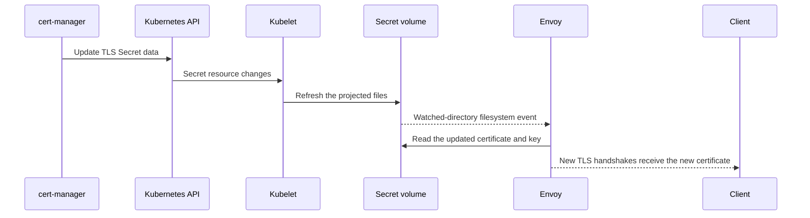

# TLS secrets and rotation

Each HTTPS server uses a Kubernetes TLS Secret. Set `tls_config.secret` on its server entry:

```yaml
servers:
  - hostname: tls.example.com
    tls_config:
      secret: auth-gateway-tls
    apis: [metrics]
```

The Secret is type `kubernetes.io/tls` and contains `tls.crt` and `tls.key`. Paths default to `/etc/<secret>/tls.crt` and `/etc/<secret>/tls.key`. Optional `certificate` and `private_key` paths can override them; both files must be in the same directory. Distinct mounts need non-overlapping directories outside the gateway and collector configuration directories. See [`config.example.yaml`](../config.example.yaml) and the [TLS test fixture](../config/testdata/server-tls/config.yaml).

For file-only Envoy output, the Secret name is optional. Without a Secret name, paths default to `/etc/auth-gateway-tls/tls.crt` and `/etc/auth-gateway-tls/tls.key`. Kubernetes output requires a Secret name for every HTTPS server.

## How Envoy reads the Secret

The generated `<name>-config` ConfigMap contains `envoy.yaml` and one `server-certificate-<index>.yaml` SDS file per HTTPS server. The index is its position in the server list. The SDS resource contains certificate file paths. The Deployment mounts these files at `/etc/auth-gateway` and each Secret read-only at its certificate directory. Envoy's bootstrap reads the SDS resource, which points to the mounted certificate and key. Envoy watches both directories.

JWT attribute mappings use a separate processing ConfigMap and Envoy's file-based ECDS reload. See [JWT authentication and request processing](jwt-auth.md) for the filter chain and mapping behavior.



A certificate update does not require an Envoy Pod restart. Each certificate must cover its server's hostname. Servers can share a Secret, in which case the certificate must cover each hostname. Identical Secret/path bindings share a mount; each HTTPS server still has its own SDS resource, SNI chain, and HTTP authority match.

Secrets are mounted as directory volumes, without `subPath`, so Kubernetes can refresh their projected files.

## Rotation test

cert-manager renews the `Certificate` according to its policy and updates the referenced Secret. The Kind end-to-end test uses `cmctl renew` to trigger that update path, then checks that a new TLS connection sees a different certificate and public key. The other server's certificate and gateway Pod UID must stay unchanged.

If a proxy terminates client TLS before Envoy and forwards plain HTTP, Envoy sees HTTP and does not present this certificate for that request.

## References

- Envoy [Secret Discovery Service](https://www.envoyproxy.io/docs/envoy/latest/configuration/security/secret)
- Envoy [`PathConfigSource`](https://www.envoyproxy.io/docs/envoy/latest/api-v3/config/core/v3/config_source.proto#envoy-v3-api-msg-config-core-v3-pathconfigsource)
- Envoy [`TlsCertificate`](https://www.envoyproxy.io/docs/envoy/latest/api-v3/extensions/transport_sockets/tls/v3/common.proto#envoy-v3-api-msg-extensions-transport-sockets-tls-v3-tlscertificate) and [`WatchedDirectory`](https://www.envoyproxy.io/docs/envoy/latest/api-v3/config/core/v3/base.proto#envoy-v3-api-msg-config-core-v3-watcheddirectory)
- Kubernetes [using Secrets as files from a Pod](https://kubernetes.io/docs/concepts/configuration/secret/#using-secrets-as-files-from-a-pod)
